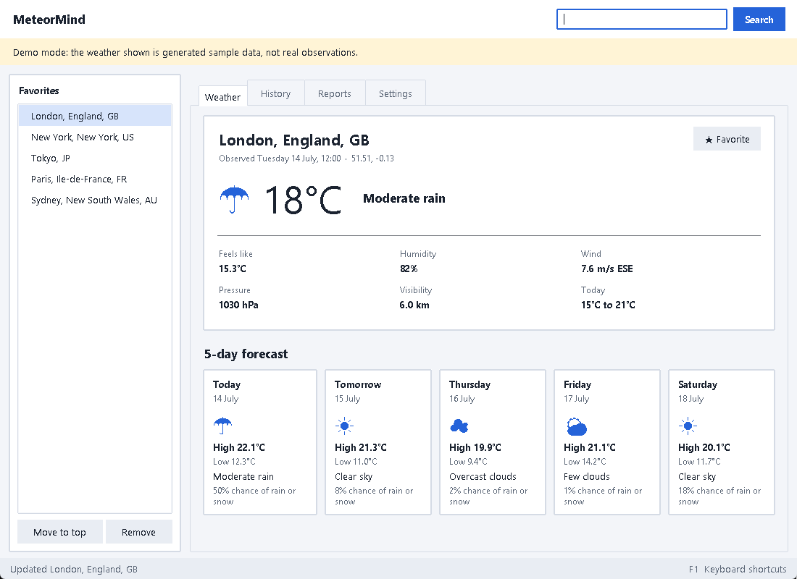
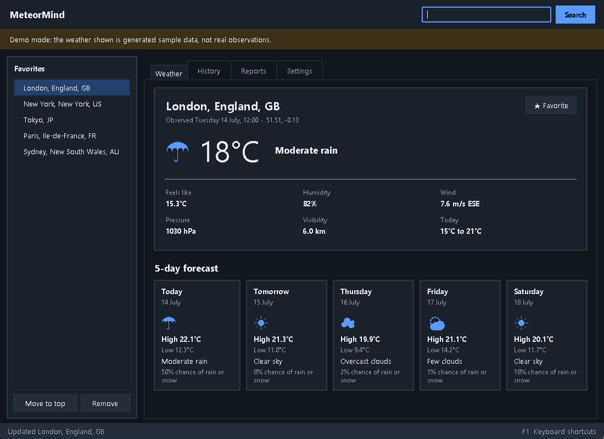
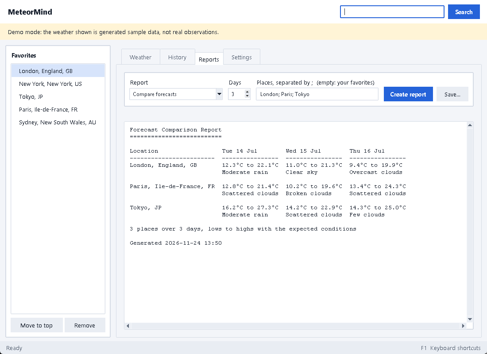
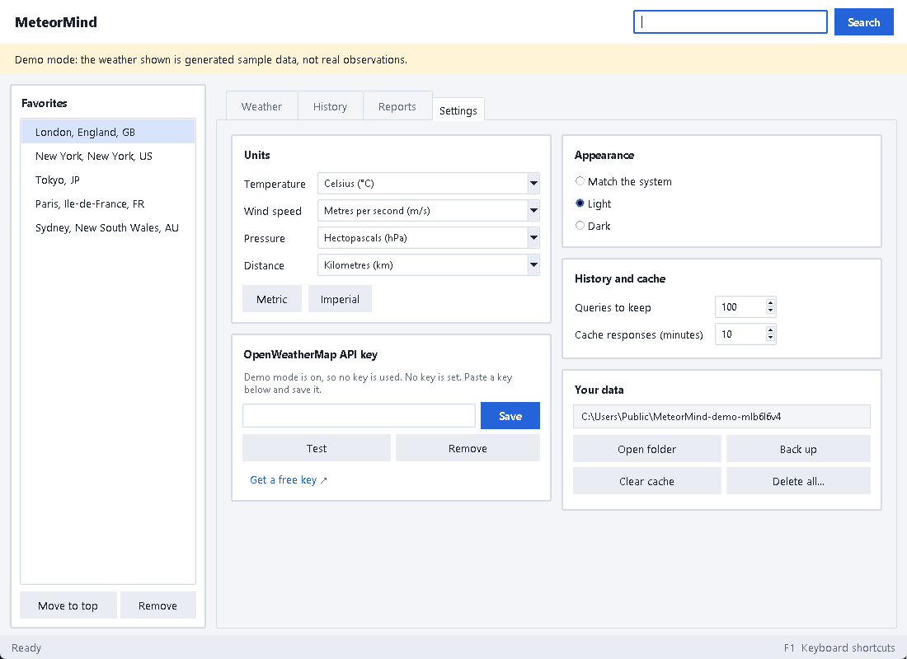
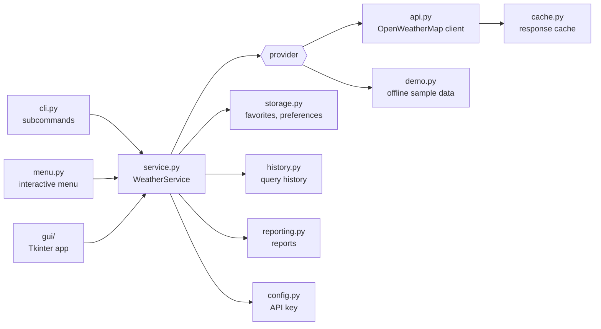

# MeteorMind

[](https://github.com/hillmatthew2000/MeteorMind/actions/workflows/ci.yml)


Current weather and five-day forecasts from [OpenWeatherMap](https://openweathermap.org/),
with a command line for quick lookups and scripts, an interactive text menu,
and a desktop app. MeteorMind keeps your favorite places and a history of
what you looked up, and builds reports from both.



- **Weather and forecasts** for any place OpenWeatherMap knows, in metric or
  imperial units (or any mix of °C/°F/K, m/s/km/h/mph/kn, hPa/mbar/inHg/atm
  and km/mi/m/ft).
- **Favorites and history**: favorites are kept most recently used first, and
  every lookup is recorded so you can search it, export it and report on it.
- **Reports**: compare current weather or forecasts across places, show a
  detailed forecast, temperature trends from your history and your most
  looked-up places, then save them as text, CSV or JSON.
- **Demo mode**: `--demo` uses built-in sample data, so everything works
  without an API key or a network connection.
- **Careful with your data**: files are written atomically, a damaged file is
  set aside instead of overwritten, API responses are cached to stay well
  inside the free plan's limits, and the API key never lives in the project
  folder.

## Contents

- [Installation](#installation)
- [API key](#api-key)
- [Command line](#command-line)
- [Desktop app](#desktop-app)
- [Where your data lives](#where-your-data-lives)
- [Architecture](#architecture)
- [Development](#development)
- [License](#license)

## Installation

MeteorMind needs Python 3.10 or newer. The desktop app uses Tkinter, which
ships with the python.org installers for Windows and macOS; on Debian or
Ubuntu install `python3-tk`.

```bash
git clone https://github.com/hillmatthew2000/MeteorMind.git
cd MeteorMind
python -m venv .venv
.venv\Scripts\activate            # Windows
source .venv/bin/activate         # macOS and Linux
pip install -e .
```

This installs two commands: `meteormind` (command line and menu) and
`meteormind-gui` (the desktop app). Without installing, `python main.py`
runs the command line straight from the checkout.

Try it right away with sample data:

```bash
meteormind --demo current Tokyo
meteormind --demo gui
```

## API key

Weather lookups need a free OpenWeatherMap key:

1. Create an account at <https://home.openweathermap.org/users/sign_up>.
2. Copy your key from <https://home.openweathermap.org/api_keys>. New keys can
   take up to two hours to start working.
3. Save it with `meteormind config set-key` (it asks without echoing, so the
   key stays out of your shell history), or in the desktop app under
   **Settings → OpenWeatherMap API key**.

MeteorMind looks for a key in this order: the `OPENWEATHER_API_KEY` or
`WEATHER_API_KEY` environment variable, then the saved configuration.
`meteormind config` shows which one is in use.

## Command line

Run `meteormind` with no command for the interactive menu, or use a
command for one-off lookups and scripts. Places can include a country code
to tell them apart: `Paris, FR`, `"Portland, US"`.

| Command | What it does |
| --- | --- |
| `meteormind current PLACE` | Current conditions; `--json` prints machine-readable output. |
| `meteormind forecast PLACE [-d DAYS]` | Daily forecast for 1–5 days, also with `--json`. |
| `meteormind favorites [list\|add PLACE\|remove PLACE]` | List or change favorites. |
| `meteormind history [list\|export FILE\|clear --yes]` | Recent lookups; `-n 50` shows more, `-s TEXT` filters by place. |
| `meteormind report KIND [PLACE ...]` | Build a report; `-o FILE` saves it, `-f txt\|csv\|json` picks the format. |
| `meteormind config [show\|set-key\|clear-key]` | Show settings, save or remove the API key. |
| `meteormind gui` | Open the desktop app. |
| `meteormind menu` | The interactive menu (the default). |

Every command accepts `--demo` and `--units metric|imperial`, before or
after the command name, and `--help`.

```console
$ meteormind --demo forecast "Cape Town" -d 3
3-day forecast for Cape Town, Western Cape, ZA
  Day           High     Low  Precip  Humidity     Wind  Conditions
  ----------  ------  ------  ------  --------  -------  ---------------
  Tue 24 Nov  23.2°C  14.1°C     19%       71%  3.0 m/s  Overcast clouds
  Wed 25 Nov  22.4°C  14.4°C      3%       53%  2.8 m/s  Few clouds
  Thu 26 Nov  24.1°C  14.8°C     16%       82%  1.8 m/s  Overcast clouds
```

When a name matches several places (there are many Springfields), the
command lists them and asks which one you mean. In scripts it uses the first
match and lists the others on standard error; `--pick N` chooses directly.
The menu and the desktop app offer the same choice.

### Reports

| Kind | Report |
| --- | --- |
| `compare` | Current weather side by side, for the places given or all favorites |
| `forecast-compare` | Daily forecasts side by side, for the places given or all favorites |
| `forecast` | A detailed forecast for one place |
| `trends` | How one place's temperature changed across your lookups |
| `locations` | Which places you look up most, with their average temperature |
| `history` | Your recent lookups |

```bash
meteormind report compare London Paris Tokyo
meteormind report forecast "New York, US" -o forecast.csv
```

[`examples/reports`](examples/reports) has a sample of each kind.

### Exit codes

`0` success, `1` the request failed (network, API or file error), `2`
invalid input, `130` interrupted. Errors and suggestions go to standard
error, so output can be piped safely.

## Desktop app

Start it with `meteormind gui` or `meteormind-gui`, adding `--demo` for
sample data. Search for a place, or pick one from the favorites on the left.
Network work happens in the background, so the window stays responsive.

| Dark theme | Reports |
| --- | --- |
|  |  |

- **Weather**: current conditions and a five-day forecast.
- **History**: every lookup, filterable, with export and clear.
- **Reports**: all report kinds, saved as text, CSV or JSON.
- **Settings**: units, light/dark/system theme, history size, cache lifetime,
  the API key (save, test, remove) and your data (open the folder, back up,
  clear the cache, delete everything).



| Shortcut | Action |
| --- | --- |
| Ctrl+L | Search for a place |
| F5 | Refresh the weather |
| Ctrl+D | Add or remove the shown place as a favorite |
| Ctrl+1 … Ctrl+4 | Weather, History, Reports, Settings |
| Ctrl+T | Switch between light and dark |
| Delete | Remove the selected favorite |
| F1 | Show all shortcuts |
| Ctrl+Q | Quit |

## Where your data lives

Favorites, history, preferences, cached responses and the saved API key are
kept in a per-user folder:

| System | Folder |
| --- | --- |
| Windows | `%APPDATA%\MeteorMind` |
| macOS | `~/Library/Application Support/MeteorMind` |
| Linux | `$XDG_CONFIG_HOME/meteormind` (usually `~/.config/meteormind`) |

Set `METEORMIND_HOME` to use a different folder. The files are plain JSON:
`favorites.json`, `history.json`, `preferences.json`, `cache.json` and
`config.json`, plus timestamped copies under `backups/`. The desktop app
also writes warnings and unexpected errors to `meteormind.log` there, which
helps when reporting a problem. Older versions
kept data in a `data` folder next to where they were started; it is copied
across on first run and left in place.

## Architecture



The three interfaces only handle input and presentation. `WeatherService`
holds everything they share: resolving place names, lookups that are
recorded in the history, favorites, preferences, reports and maintenance.
It talks to a *provider*, either the real OpenWeatherMap client or the
deterministic demo provider, which is also what the tests and screenshots
use.

| Module | Responsibility |
| --- | --- |
| `models.py` | Locations, observations, forecasts, history entries and the favorites list |
| `units.py` | Unit conversion and display formatting |
| `validation.py` | Checking place names, country codes and menu input |
| `api.py` | Geocoding, current weather and forecasts, with retries and typed errors |
| `cache.py` | Time-limited response cache, saved between runs |
| `storage.py`, `jsonio.py` | Atomic JSON files, migration of older layouts, backups |
| `preferences.py` | Units, theme, history size and cache lifetime |
| `history.py` | The query history and its statistics |
| `reporting.py` | Report tables, rendered as text, CSV or JSON |
| `console.py` | Width-aware text tables for the terminal |
| `gui/` | Main window, widgets, light and dark themes, and a background worker |

## Development

```bash
pip install -e ".[dev]"
pytest                    # the test suite never touches the network
pytest --cov              # with coverage (at least 85% required)
ruff check . && ruff format --check .
mypy                      # strict mode, configured in pyproject.toml
```

GitHub Actions runs all of these on Ubuntu and Windows with Python 3.10 and
3.13. The desktop tests open real windows; on Linux without a display, run
them under `xvfb-run`.

The sample reports in `examples/reports` are generated from the demo data
with a fixed date. After changing how reports look, regenerate them with
`python examples/sample_reports.py`; a test checks they are up to date.

## License

MIT; see [LICENSE](LICENSE).
